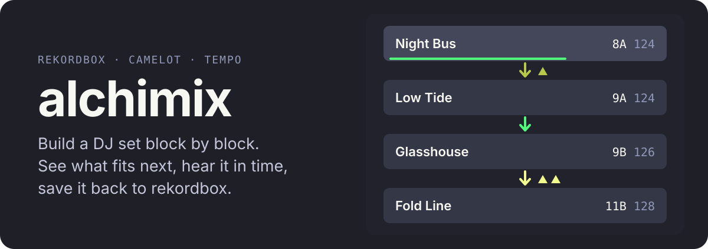

<p align="center">
  
</p>

<p align="center">
  
  
  
</p>

alchimix is a desktop playlist builder for a rekordbox collection: pick a seed track, see what can follow it by Camelot key and tempo, and stack blocks into a set. Preview tracks in sync on a shared bar clock, then write the crate back into a rekordbox playlist.

## Quick start

1. Install the system libraries:

   ```sh
   brew install sqlcipher ffmpeg
   ```

2. Build and run with Zig 0.17:

   ```sh
   zig build && ./zig-out/bin/alchimix
   ```

3. Run the tests:

   ```sh
   zig build test
   ```

SDL3, dvui, FreeType and the rest come in as Zig packages. Without a rekordbox key the app opens with three demo tracks.

| Command | Prints |
|---|---|
| `alchimix` | the block canvas |
| `alchimix library` | track count and how many carry a key |
| `alchimix suggest <text>` | what could follow the first match, ranked |

## Reading the arrows

Blocks stack down the canvas. The `↓` between two blocks is coloured by the harmonic step; triangles beside it show which way the energy moves.

| Colour | Camelot step | Triangles |
|---|---|---|
| green | 0, relative | none |
| olive | ±1 | 1 |
| yellow | ±2 | 2 |
| orange | ±5 | 3 |
| red | ±3, ±4, ±6 | none, not harmonic |

Tempo matching counts half and double time.

## Editing a crate

| Action | Result |
|---|---|
| Drag a row from the left column onto the canvas | inserts it; a click alone adds nothing |
| Drag a block onto a gap line | moves it |
| Press a block | selects it; suggestions follow the selection |
| `×` on a block | removes it |
| `U` | undoes crate and playlist edits, newest first |

Moving or inserting blocks keeps each playing lane's position. Removing a block cancels its playing pass and any queued replacement.

## Playback

`▶` on a row or block plays fifteen seconds from the middle of the track through `ffplay`, with a progress bar along the block. While the grid plays, a preview waits for the next master bar and matches the master tempo.

| Control | Does |
|---|---|
| `space` / footer `play` | starts the last four tracks that played, together |
| footer `stop` | stops every lane |
| drag the waveform | jogs; release lands on the nearest beat |
| drag the overview | seeks by bars |
| shift-press the overview | loops four bars from the bar under the pointer |
| shift-drag the overview | loops the bars it covers |
| shift-drag a loop edge | moves that edge a beat at a time |
| shift-right-click a loop | drops it |
| `M` under a lane's play button | mutes it; the clock keeps running |
| EQ nodes on the lane spectrum | low shelf, bell, high shelf; HPF/BPF/LPF presets |
| trim slider | lane gain, doubles as a level meter |

- Up to eight lanes share one mixer clock; every start lands on a bar.
- The master tempo is the analysed tempo of the seed, or of the first lane started when the crate has no seed.
- With several lanes, tempo changes land together on one bar.
- Waveforms use rekordbox's three bands: kick red, mid green, high blue. Phrase marks show under the overview when the analysis has them.
- The footer sets the waveform span: 16, 32 or 64 beats.

## Playlists

The right column lists rekordbox playlists and folders.

| Action | Result |
|---|---|
| Click a playlist | loads its tracks into the crate in order |
| `save` | writes the crate into that playlist, or a new one named after the seed |
| shift-press `save` | type the name; a name already in the library is refused |
| shift-click a row | renames it |
| shift-right-click a row, then `Delete ?` | deletes the playlist; its tracks stay in the collection |

- Folders that still hold playlists cannot be deleted.
- Intelligent playlists and `CUE Analysis Playlist` entries are hidden.
- Undoing a delete restores the playlist under its parent at its old position.

## Visual modes

The mode chips overlay the canvas with tempo-driven visuals. Every mode maps the pointer through the same transform as the picture, so clicks land on the control under the cursor, and the chips themselves never move.

| Mode | Look |
|---|---|
| drift | the window flows through a moving displacement field with split colour channels and a lens flare |
| fold | the window repeats as a rotating tunnel of nested copies; sliders set size, wander, ring count, colour and mirror sectors, and the kick swells it |
| garden | an ASCII undergrowth in Caskaydia Mono: plants, rain, insects, a snail, and a shamrock that grows into a tree while music plays |

The effect clock runs at master tempo / 128, so faster tracks move faster. A speed slider scales drift and fold. The `garden` column toggles eight behaviours.

## Keys

Overrides live in `$XDG_CONFIG_HOME/alchimix/keys` or `~/.config/alchimix/keys`, one `name = key` per line:

```
undo = u
play = space
```

## rekordbox access

| Fact | Detail |
|---|---|
| Database | `~/Library/Pioneer/rekordbox/master.db`, opened with SQLCipher |
| Key | `ALCHIMIX_REKORDBOX_KEY`, else pyrekordbox's cache at `~/Library/Application Support/pyrekordbox/rb.cache` |
| Writes | playlists only: create, replace tracks, rename, delete; one transaction each |
| Never written | tracks, cue points, analysis |
| Write guard | refused while `rekordbox` runs (chip reads `rb open`); fails closed if the process list is unreadable |
| Stale guard | `save` refused as `stale` when the playlist changed in rekordbox since it was opened |

Every touched row takes the next `agentRegistry.localUpdateCount`, as pyrekordbox does.

Limit: `masterPlaylists6.xml` is not updated; whether rekordbox rebuilds it on launch is untested.

## Layout

| Path | Holds |
|---|---|
| `src/domain/` | Camelot wheel, tempo match, crate, suggestion ranking |
| `src/ports/library.zig` | the track-source port; implement it to read another library |
| `src/adapters/rekordbox.zig` | SQLCipher reader and playlist writer for rekordbox 6 |
| `src/adapters/memory.zig` | in-memory source for tests and the demo |
| `src/ui/` | block canvas, playlist column, hit testing, visual modes, frame loop |
| `src/audio/` | transport (bar joins, jog, retune) and mixer (shared output clock) |

## Fonts

Caskaydia Cove (body) and Caskaydia Mono (ASCII art) are compiled in from `src/assets`, under the OFL 1.1 licence beside them. Noto Emoji ships in `assets/` with its licence.
